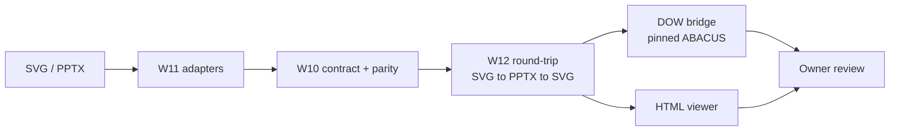

# orchestration-sandbox — public review dock for the gg_Engine semantic-diagram pilots

<!-- markdownlint-disable MD001 MD013 MD022 MD029 MD031 MD032 MD033 MD040 MD060 -->

[](https://github.com/GBOGEB/orchestration-sandbox/actions/workflows/gg-engine-w12-convergence.yml)
[](.github/workflows/gg-engine-w12-convergence.yml)
[](#6-status-and-open-gates)
[](#6-status-and-open-gates)

> **A public, review-only dock where the gg_Engine pilots (W10 contract → W11 native adapters → W12 cross-format round-trip) are staged with synthetic fixtures, tests and checksummed bundles — nothing here is engineering acceptance.**

## At a glance

| | |
|---|---|
| **Domain** | Semantic contracts for engineering diagrams: turning SVG and PPTX drawing objects into typed graph claims, and proving they survive cross-format round-trips |
| **EPICs carried here** | **gg_Engine W10** contract ([#2](https://github.com/GBOGEB/orchestration-sandbox/pull/2), [#4](https://github.com/GBOGEB/orchestration-sandbox/pull/4)) · **W11** native adapters ([#3](https://github.com/GBOGEB/orchestration-sandbox/pull/3)) · **W12** convergent pilot ([#6](https://github.com/GBOGEB/orchestration-sandbox/pull/6)) — all merged 13 Nov 2026 |
| **Owner and decision authority** | Repository owner **GBOGEB**: admission to the default branch, releases and every external grant. No agent, bot or CI verdict holds this authority. |
| **Role in the federation** | The *public sandbox*: public-safe, synthetic-only copies of pilot code for review; private sources stay in private repos. |
| **Owns** | `gg_engine_contract/` (W10), `gg_engine_w11/`, `gg_engine_w12/`, the HTML review navigator and the `dist/` bundles with SHA-256 sums |
| **Does not own** | The DOW SVG engine (ABACUS, pinned by SHA) · real owner drawings, legends and engineering SSOT (owner-controlled, private) · KEB receipts (CODEX) |
| **Status snapshot** | `main@5b24167`, read 15 November 2026 — 0 open issues, 0 open PRs. [Details ↓](#6-status-and-open-gates) |

**New here?** Read [§1](#1-why-orchestration-sandbox-exists--bios), then the route that matches you:

| I want to… | Open this first |
|---|---|
| See the latest pilot | [W12 README](gg_engine_w12/README.md) and [W12 review pages](docs/gg_engine/w12/README.md) |
| Browse all stages in a browser | [HTML navigator](docs/gg_engine/index.html) (open locally) |
| Understand the contract | [W10 README](gg_engine_contract/README.md) and [handover](gg_engine_contract/HANDOVER.md) |
| Verify a bundle | [`dist/`](dist/) checksums |
| Run the tests | [Run it locally](#7-run-it-locally) |

## 1. Why orchestration-sandbox exists — BIOS

**B — Baseline.** Three stages are merged on `main`: W10 contract, W11 adapters, W12 convergent pilot. Bundles: `dist/gg_engine_w10_source.zip` and `dist/gg_engine_w12_demo.zip`, each with a SHA-256 list.

**I — Identity and integrity.** Caches and receipts bind to source SHA-256, adapter version, legend SHA-256 and contract version. W12 verifies the exact pinned ABACUS SHA before importing the DOW engine.

**O — Orchestration with ownership.** Each stage imports the previous one's gates instead of copying them (W11 via `w10_bridge.py`; W12 via the merged W11 readers).

**S — Safety and source-qualified status.** Synthetic fixtures only. Real owner sources, PowerPoint/Inkscape native-open checks and independent DOW review are **not run**; GOLDEN / engineering SSOT is on **HOLD**.

**Where authority lives:** [`gg_engine_contract/HANDOVER.md`](gg_engine_contract/HANDOVER.md) · [`gg_engine_w11/HANDOVER.md`](gg_engine_w11/HANDOVER.md) · [`gg_engine_w12/HANDOVER.md`](gg_engine_w12/HANDOVER.md) · [`gg_engine_w12/PINNED_UPSTREAM.json`](gg_engine_w12/PINNED_UPSTREAM.json).

## 2. From source to decision

1. Native drawing (SVG or PPTX) → W11 adapter reads objects and connectors.
2. W10 contract validates the graph claim (hashes, IDs, typed edges, legend evidence).
3. W10 parity gate compares two representations for dropped objects and reversed edges.
4. W12 round-trips SVG → PPTX → SVG and checks parity at two checkpoints.
5. DOW bridge renders a layered PDF through the pinned ABACUS engine (review-only).
6. HTML viewer shows objects, evidence and discrepancies for a human reviewer.
7. Owner review decides; nothing promotes itself.

## 3. What is inside

| Block | Native source | Input → output | Boundary |
|---|---|---|---|
| W10 contract | [`gg_engine_contract/`](gg_engine_contract/) | Graph claim → validated manifest, parity receipt, cache keys | `PASS_CONTRACT_ONLY`: structure, not authority |
| W11 native adapters | [`gg_engine_w11/`](gg_engine_w11/) | PPTX/SVG objects → W10 graph claims | `PASS_SEMANTIC_PARITY_ONLY` on synthetic inputs |
| W12 pilot | [`gg_engine_w12/pilot.py`](gg_engine_w12/pilot.py) | SVG → PPTX → SVG with two parity checkpoints | Fixture-only emitter; refuses ambiguous graphs |
| DOW bridge | [`gg_engine_w12/dow_bridge.py`](gg_engine_w12/dow_bridge.py) | Claims → nested-OCG PDF via pinned ABACUS engine | `PASS_REVIEW_ONLY` |
| Evidence ingress | [`gg_engine_w12/evidence_ingress.py`](gg_engine_w12/evidence_ingress.py) | DOCX, XLSX, Visio, PNG → read-only records | No OCR, no fuzzy matching |
| Review surfaces | [`viewer.py`](gg_engine_w12/viewer.py), [`docs/gg_engine/`](docs/gg_engine/) | Results → offline clickable HTML | Schematic, not geometry |

## 4. Where orchestration-sandbox sits in the federation

| Neighbour | Keeps | Interface with orchestration-sandbox |
|---|---|---|
| [ABACUS](https://github.com/GBOGEB/ABACUS) | DMAIC runtime, CI repair at source | W12 imports `DMAIC_V3.svg_engine` at a pinned SHA |
| Owner-controlled private SSOT | Engineering drawings, legends and acceptance | Never mirrored here; private runs happen there |
| [CODEX](https://github.com/GBOGEB/CODEX) | Federation governance, contracts, wave roll-up | KEB receipts: not issued |

## 5. Process diagrams

Declared architecture, not a run receipt.



## 6. Status and open gates

**Snapshot: `main@5b24167`, read 15 November 2026.** Rows point at live owners; open the link for the current position.

| Gate | Status | What would close it |
|---|---|---|
| W10–W12 pilots | **Merged** 13 Nov 2026; synthetic tests on Python 3.9 and 3.12 | — |
| Real owner sources | **Not run**; fixtures cannot substitute | A private run on owner drawings with an engineer-reviewed legend |
| Native-open checks | PowerPoint and Inkscape open **not claimed** | Generated files validated by those tools |
| Independent DOW review | **Not yet performed** | Review by someone other than the author |
| Licence | **Not yet declared**: no `LICENSE` file in this public repository | Owner adds a licence (GBOGEB as source generator and owner) |

## 7. Run it locally

Python 3.9 and 3.12 are the CI legs; standard library only. From the repository root:

```bash
python -m unittest discover -s gg_engine_contract -p 'test_*.py' -v
python -m unittest discover -s gg_engine_w11 -p 'test_*.py' -v
python -m unittest discover -s gg_engine_w12 -p 'test_*.py' -v
python gg_engine_w12/pilot.py --out w12-out
```

Verify bundles from inside `dist/` (the sum files list bare filenames): `(cd dist && sha256sum -c SHA256SUMS.txt && sha256sum -c SHA256SUMS_W12.txt)`. The W12 DOW bridge needs an ABACUS checkout at the SHA in [`PINNED_UPSTREAM.json`](gg_engine_w12/PINNED_UPSTREAM.json).

## 8. Evidence rules and non-compensation

- **Public-safe only**: no private sources, repository pointers, names or credentials.
- **Proof tiers do not stack**: contract-only, parity-only and review-only passes never add up to acceptance.
- **Not run is said plainly**: real sources, native-open and independent review.
- **Import, never copy** earlier gates.

## 9. Repository map and next actions

| Folder | Open it for |
|---|---|
| [`gg_engine_contract/`](gg_engine_contract/) | W10 contract, parity gate, cache keys |
| [`gg_engine_w11/`](gg_engine_w11/) | Native PPTX/SVG adapters |
| [`gg_engine_w12/`](gg_engine_w12/) | Round-trip pilot, DOW bridge, evidence ingress, viewer |
| [`docs/gg_engine/`](docs/gg_engine/) | HTML navigator and W12 review artefacts |
| [`dist/`](dist/) | Source and demo bundles with checksums |

**Next actions** (match §6): declare a licence → private run on owner drawings → native-open validation → independent DOW review.

---

BIOS: Baseline · Identity · Orchestration · Safety. Admission authority: **GBOGEB**. Licence: not yet declared. Landing R2 on the [GEMINI skeleton](https://github.com/GBOGEB/GEMINI/blob/main/docs/landing/LANDING_SKELETON.md), snapshot `main@5b24167`.
